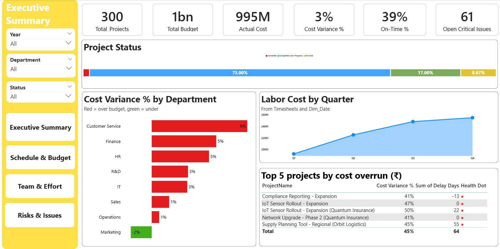
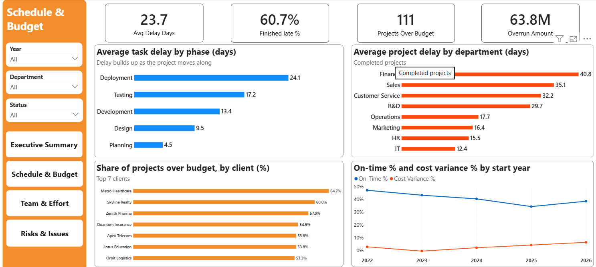
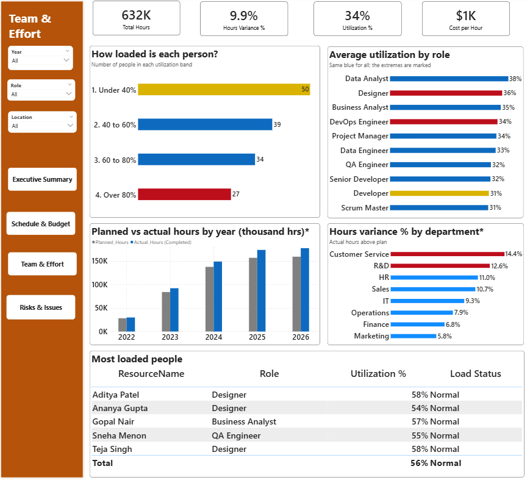
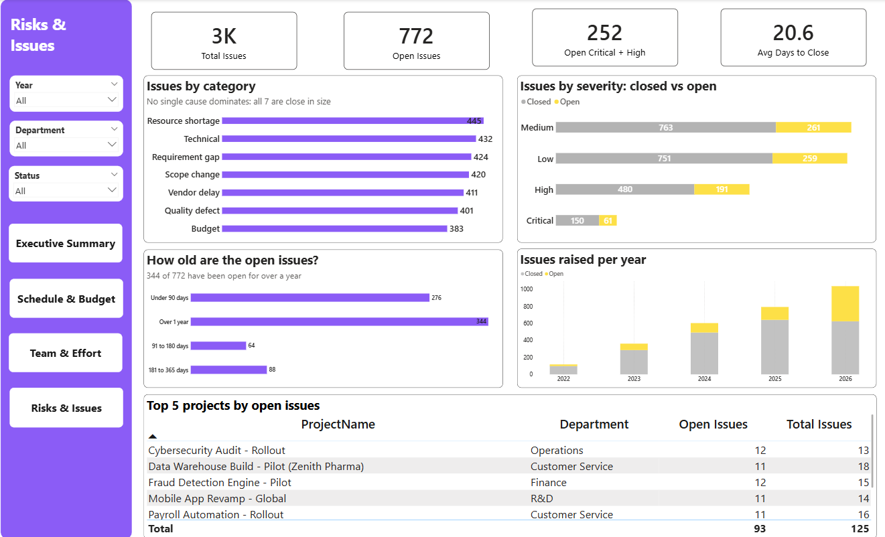
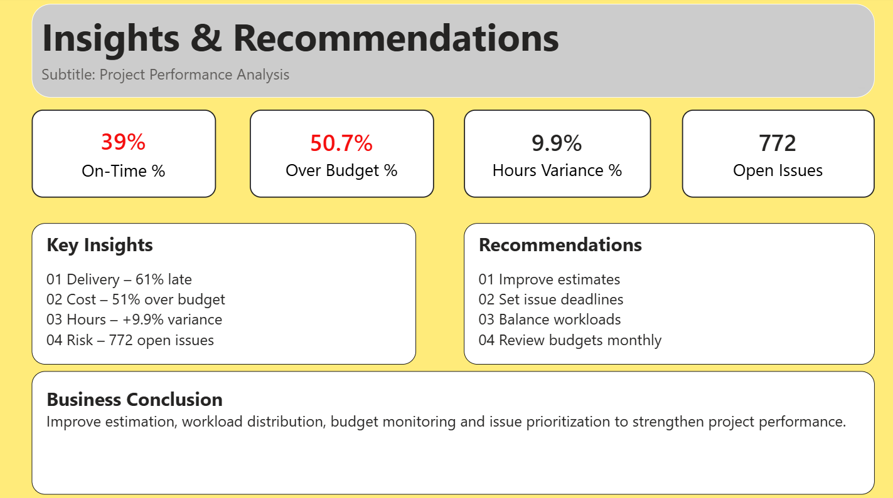

# 📊 Project Management Analytics | Power BI


## 🚀 Project Overview

The **Project Management Analytics Dashboard** is an interactive Business Intelligence project developed using Microsoft Power BI to analyze and monitor organizational project performance.

The objective of this project is to transform raw project management data into meaningful business insights by analyzing project delivery, budget performance, schedule delays, resource utilization, and project risks.

The solution provides a centralized view of project operations through interactive dashboards, KPI cards, data visualizations, and dynamic filters.

It helps stakeholders identify performance gaps, monitor project progress, understand operational challenges, and make data-driven decisions.

---

## 🎯 Project Objectives

- Monitor overall project performance and project status.
- Analyze planned budgets against actual project costs.
- Identify projects experiencing budget overruns.
- Evaluate project delays across departments and phases.
- Analyze employee workload and resource utilization.
- Compare planned working hours with actual working hours.
- Monitor project risks, issues, and severity levels.
- Identify unresolved and critical project issues.
- Generate actionable business insights and recommendations.

---

# 📊 Dashboard Overview

This project consists of five interactive dashboard pages.

## 1️⃣ Executive Summary

Provides a high-level overview of organizational project performance and financial health.



### Key Performance Indicators

| KPI | Description |
|---|---|
| Total Projects | Total number of projects |
| Total Budget | Overall allocated project budget |
| Actual Cost | Actual expenditure |
| Cost Variance % | Difference between planned and actual costs |
| On-Time % | Percentage of projects completed on time |
| Open Critical Issues | Number of unresolved critical issues |

### Visualizations

- Project Status Distribution
- Cost Variance % by Department
- Labor Cost by Quarter
- Top 5 Projects by Cost Overrun

### Business Purpose

Understand overall project health, identify financial deviations, and monitor project performance across departments.

---

## 2️⃣ Schedule & Budget

Analyzes project timelines, schedule delays, budget utilization, and financial performance.



### Key Performance Indicators

| KPI | Description |
|---|---|
| Average Delay Days | Average project delay |
| Finished Late % | Percentage of projects completed late |
| Projects Over Budget | Number of projects exceeding their budgets |
| Overrun Amount | Total amount exceeding planned budgets |

### Visualizations

- Average Task Delay by Phase
- Average Project Delay by Department
- Share of Projects Over Budget by Client
- On-Time % and Cost Variance % by Start Year

### Business Purpose

Identify departments and project phases experiencing delays, understand budget overruns, and improve project planning.

---

## 3️⃣ Team & Effort

Evaluates employee workload, resource utilization, working hours, and workforce performance.



### Key Performance Indicators

| KPI | Description |
|---|---|
| Total Hours | Total recorded working hours |
| Hours Variance % | Difference between planned and actual hours |
| Utilization % | Resource utilization percentage |
| Cost per Hour | Average labor cost per working hour |

### Visualizations

- Employee Workload Distribution by Utilization Band
- Average Utilization by Role
- Planned vs Actual Hours by Year
- Hours Variance % by Department
- Most Loaded Employees

### Business Purpose

Identify overloaded employees, understand resource allocation, compare planned and actual working hours, and improve workforce management.

---

## 4️⃣ Risks & Issues

Analyzes project issues, severity, resolution performance, and outstanding risks.



### Key Performance Indicators

| KPI | Description |
|---|---|
| Total Issues | Total recorded project issues |
| Open Issues | Number of unresolved project issues |
| Open Critical + High | Number of unresolved critical and high-severity issues |
| Average Days to Close | Average time taken to resolve issues |

### Visualizations

- Issues by Category
- Issues by Severity: Closed vs Open
- Ageing Analysis of Open Issues
- Issues Raised per Year
- Top 5 Projects by Open Issues

### Business Purpose

Identify critical issues, monitor unresolved problems, analyze issue ageing, and improve risk management and issue resolution.

---

## 5️⃣ Insights & Recommendations

Converts dashboard findings into actionable business recommendations.



### Key Findings

**1. Project Delivery Performance**

- Only 39% of completed projects were delivered on time.
- Average project delay was 23.7 days.
- Deployment experienced the highest average task delay.

**2. Budget Performance**

- 111 out of 219 completed projects exceeded their budgets.
- Total overrun amount was ₹63.8 million.
- Net cost variance was approximately +2.7%.

**3. Workforce Planning**

- Actual working hours exceeded planned hours by 9.9%.
- Customer Service and R&D showed the highest departmental hours variance.
- Resource utilization increased significantly over the analyzed period.

**4. Risk Management**

- 772 issues remained open.
- 252 issues were classified as critical or high severity.
- 344 open issues had remained unresolved for over one year.

### Key Recommendations

| Area | Recommendation |
|---|---|
| Project Estimation | Improve effort estimation using historical project data |
| Issue Management | Introduce resolution deadlines based on issue severity |
| Project Completion | Review critical and high-severity issues before project closure |
| Resource Management | Rebalance workloads among employees |
| Budget Control | Monitor actual expenditure against planned budgets |
| Schedule Management | Introduce phase-level reviews and schedule buffers |

### Business Purpose

Translate analytical findings into practical actions that improve project delivery, financial control, resource planning, and risk management.

---

# 🗂️ Dataset Description

The project uses project management data organized into six analytical tables.

| Table | Description |
|---|---|
| Projects | Project details, departments, budgets, status, and costs |
| Tasks | Project tasks, phases, and schedule information |
| Resources | Employee details, roles, and locations |
| Timesheets | Actual working hours and labor cost information |
| Issues | Project issues, categories, severity, and resolution details |
| Dim_Date | Date dimension for time-based analysis |

### Data Model

The data model connects project, task, resource, timesheet, issue, and date information to support cross-functional analysis.

---

# 🛠️ Tools & Technologies

| Technology | Application |
|---|---|
| Microsoft Power BI | Dashboard development |
| Power Query | Data cleaning and transformation |
| DAX | KPI calculations and analytical measures |
| Data Modeling | Table relationships and analytical model |
| Power BI Visualizations | Business reporting and analysis |
| Interactive Slicers | Dynamic report filtering |

---

# 📐 Power BI Concepts Applied

### Data Preparation

- Data cleaning and transformation
- Data type handling
- Data validation
- Power Query transformations

### Data Modeling

- Multiple related tables
- Fact and dimension table concepts
- Date dimension
- Table relationships

### DAX & KPI Analysis

- Business KPI calculations
- Financial performance measures
- Project delay analysis
- Resource utilization measures
- Issue management measures
- Time-based analysis

### Data Visualization

- KPI Cards
- Bar Charts
- Stacked Bar Charts
- Column Charts
- Line Charts
- Tables
- Interactive Slicers

### Report Interactivity

- Year filtering
- Department filtering
- Status filtering
- Role filtering
- Location filtering
- Dashboard page navigation

---

# 💡 Key Business Value

This project demonstrates how Power BI can support project management decisions across multiple business functions.

**Financial Management**

- Identify budget overruns.
- Monitor project expenditure.
- Improve financial planning.

**Schedule Management**

- Analyze project delays.
- Identify departments with poor delivery performance.
- Improve project scheduling.

**Resource Management**

- Monitor employee utilization.
- Identify workload imbalances.
- Improve resource allocation.

**Risk Management**

- Identify critical unresolved issues.
- Monitor issue ageing.
- Improve issue prioritization.

**Strategic Decision-Making**

- Convert analytical findings into recommendations.
- Track performance using KPIs.
- Support continuous project improvement.

---

# 📁 Repository Structure

```text
Project-Management-Analytics/
│
├── Dashboard/
│   └── Project_Management_Analytics.pbix
│
├── Project-Management-Dataset/
│   └── Dataset files
│
├── Screenshots/
│   ├── Executive_Summary.png
│   ├── Schedule_Budget.png
│   ├── Team_Effort.png
│   ├── Risks_Issues.png
│   └── Insights_Recommendations.png
│
└── README.md
